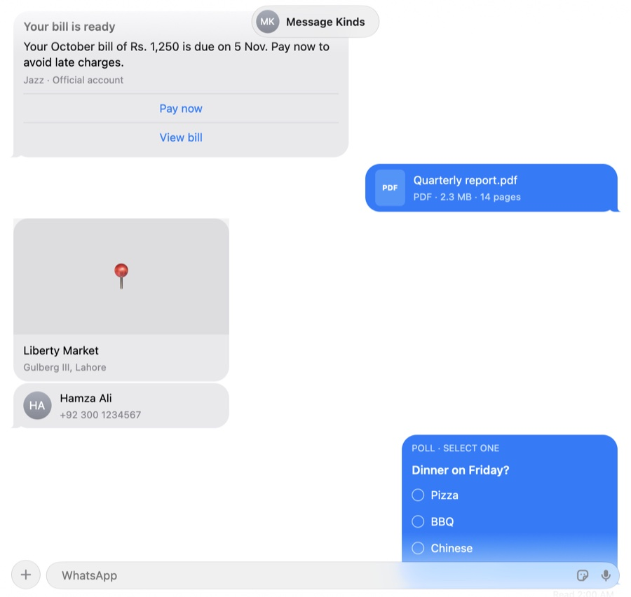
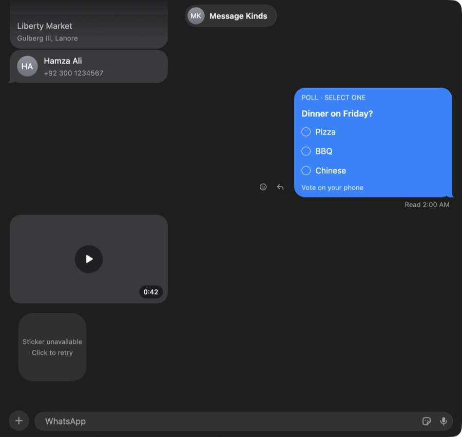
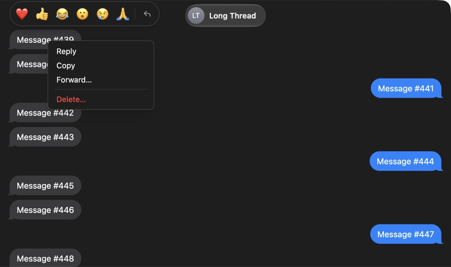
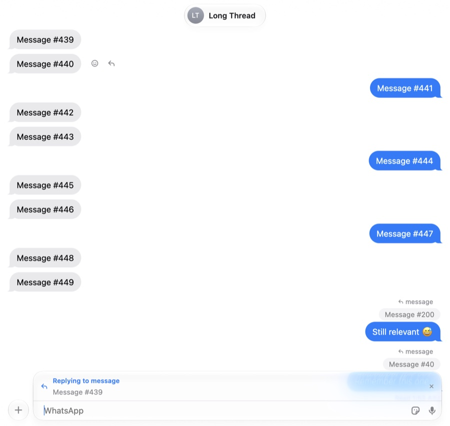
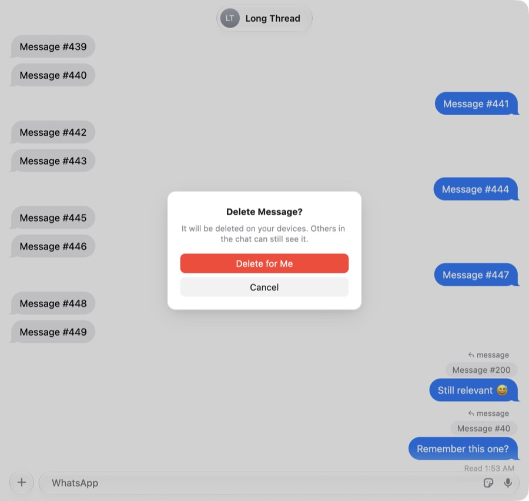

# Liquid Glass for the conversation header and composer

Branch `liquid-glass`. The conversation header and composer use Apple's real Liquid Glass
(`NSGlassEffectView`, macOS 26+) and float over the transcript, which scrolls underneath
them. Below macOS 26, or with `WA_GLASS=0`, the app keeps its previous solid look.

| Light, transcript under the header and the composer | Dark |
| --- | --- |
|  |  |

| Menu and tapback tray over the header glass | Reply bar inside the field's glass | Modal dims the glass too |
| --- | --- | --- |
|  |  |  |

## The problem

`NSGlassEffectView` samples whatever sits behind it, including a `CAMetalLayer`
(verified with a standalone AppKit test; `NSVisualEffectView` with `.withinWindow` does
not, it renders opaque). But GPUI draws the whole window, header and composer included,
into a single `CAMetalLayer`. A glass view placed over the header would blur the header's
own title and avatar. Apple's model is that content belongs in the glass view's
`contentView`, above the glass.

## Options considered

| Approach | Verdict |
| --- | --- |
| **Render parts of the window into extra Metal surfaces hosted inside the glass views** | **Chosen.** Content stays GPUI (same elements, theme, hit testing, focus, IME); the list renders into the main layer beneath. Needs a small renderer patch. |
| Transparent child `NSWindow`s over the bars, each a second GPUI window | Two GPUI windows share entities but not focus, key window, IME or hit testing; the composer's text input and its popups would have to cross windows. Child windows also lag the parent during resize. Rejected. |
| Native AppKit controls for the bars (NSTextView composer, NSButton header) | Real glass with no renderer work, but the composer (mentions, emoji completion, voice-note recorder, attachment tray, reply/edit bars, drag and drop) would have to be rewritten in AppKit, and its look would diverge from the GPUI UI. Rejected. |
| Fake glass drawn by GPUI (backdrop blur shader) | Being explored separately in the main checkout. Not Apple's material (no refraction, no adaptive tint, no system updates). |

## How it works

### GPUI: scene panes (`vendor/gpui-pre`)

`Window::paint_pane(id, bounds, corner_radius, material, f)` routes every primitive
painted inside `f` into a **pane**: a child `Scene` stored on the main scene, in
pane-local coordinates (origin at the pane's top-left, whole device pixels). The main
scene still records the paint operations, so cached views replay into the right pane.
Layout, hit testing, focus, input handlers, cursor styles and tooltips are untouched:
only where the pixels go changes. Materials are `Plain` (transparent surface above the
main one) and `Glass { clear, tint }`.

When the frame has glass panes, deferred draws (menus, popovers, context menus), the
prompt, the drag preview and tooltips are painted into a full-window plain pane above
everything. They are overlays by definition and must not end up under the glass. That
pane only exists in frames that have overlays.

`PlatformWindow::supports_glass_panes()` (default `false`) tells the app whether the
platform renders panes. Platforms that don't would draw nothing for a pane, so the app
only uses panes when it returns `true`.

### Renderer (`vendor/gpui-pre-apple/src/metal_renderer.rs`)

- `draw_with_panes(scene, panes, transaction)` encodes the main scene and each pane's
  scene into its own drawable **in one command buffer**, and presents them together.
  One instance buffer and the same pipelines, atlas and path textures are shared.
- Each pane has its own `CAMetalLayer` (`new_pane_layer`, transparent, configured like
  the main one, sized to the pane only, so there are no full-window extra drawables).
- **Unchanged panes are skipped.** A fingerprint (hash of the pane's primitives, plus
  its size) is kept per layer; if it matches, the pane isn't drawn or presented and its
  layer keeps showing the previous drawable. While scrolling under the bars only the
  main surface is redrawn. Paths and video surfaces always count as changed.
- Snapshots (`--features snapshots`) composite pane content back into window
  coordinates, so `WA_DEBUG_UI … shot` still shows the header and composer. They can't
  show the glass itself, which only exists in WindowServer.
- `GPUI_FRAME_STATS=<file>` logs per-frame encode time, GPU start/end and present
  timestamps (used for the numbers below; zero cost when unset).

### macOS (`vendor/gpui-pre-macos/src/panes.rs`, `window.rs`)

- Each pane gets a layer-hosting `GPUIPaneView` whose layer is the pane's `CAMetalLayer`.
  Glass panes wrap it in a `GPUIGlassPaneView` (an `NSGlassEffectView` subclass) as its
  `contentView`, with the pane's corner radius, style and tint. All of them are subviews
  of the GPUI view, stacked in paint order.
- None of these views take part in hit testing (`hitTest:` returns nil), so mouse,
  scroll, drag and drop all still reach the GPUI view.
- Views are reconciled by pane id each frame. Frames, radii and drawable sizes are only
  touched when they change, inside a `CATransaction` without implicit animations.
- **Sync:** when any pane moved or resized, that frame presents with
  `presentsWithTransaction` inside the same transaction, so view geometry and pixels
  commit together. During live resize GPUI already presents with transactions, and pane
  layers follow. The window-state lock is released before the transaction commits:
  AppKit's display-cycle flush calls back into the GPUI view
  (`_opaqueRectForWindowMoveWhenInTitlebar`), and holding the lock deadlocked the app on
  its first glass frame. That was found and fixed during this work.
- `GPUI_GLASS_CONTAINER=1` groups glass panes in one `NSGlassEffectContainerView`. It's
  off by default because it measured slower (below).

### App (`crates/app`)

- `glass.rs`: `glass(id, radius, child)` paints a child into a glass pane;
  `above_glass(id, child)` paints into a plain pane above the glass. `glass::enabled()`
  is true when the window supports glass panes and `WA_GLASS` isn't `0`.
- Header: a glass capsule (avatar, name, typing label) centered over the transcript. The
  composer band is clear: the `+` button and the field (with its reply/edit/mic bars and
  attachment tray) are separate glass shapes. Both bars sit over a GPUI-drawn soft edge
  fade (the transcript fades into the window background), standing in for
  `NSScrollEdgeEffectStyle`, which needs an `NSScrollView`.
- The transcript already extended under both bars with content insets (`pt`/`pb`), so the
  first and last messages scroll fully into view. The bottom fade follows the composer's
  real height (reply bar, attachment tray).
- Delete and forward modals and the photo viewer use `above_glass`, so their backdrops dim
  the glass as well. Emoji/mention suggestions and the sticker panel sit above the
  composer, outside the glass. Menus are overlays (see above).
- Verified on macOS 27, light and dark, in mock mode:
  - typing, the emoji popup and the send button
  - the context menu and tapback tray over the header
  - the reply bar, the attachment tray via drag and drop, the find bar
  - the scroll-to-bottom button and the delete modal
  - window resizes (scripted `set size`; a live mouse-drag resize wasn't scripted)
- Debug and test hooks: `WA_DEBUG_UI` gains `scroll x,y dy` and `scrollbench x,y secs`.
  `WA_GLASS=clear` and `WA_GLASS_PLAIN=<pane ids>` exist for the measurements below.

## Measurements

Setup: M4 Pro, built-in 120 Hz XDR display, macOS 27.0. Signed release builds
(`packaging/release.sh --no-notarize`), mock mode, a fresh `HOME`, default 1080×720 pt
window in front. Other apps stayed open (WindowServer numbers include their constant
share, so compare differences).

- **scroll**: "Long Thread", `scrollbench` for 10 s (one 9.6 pt scroll event per 8 ms,
  1.5 s each way).
- **anim**: "Weekend Hiking" with two people typing. The typing bubble animates
  continuously and the header shows "… are typing…" (in the glass pane).

Each configuration ran 2–3 times, alternating:
- **stats run:** app and WindowServer CPU time over 8 s, memory footprint, and the
  app's own frame stats.
- **trace run:** Metal System Trace (`xctrace`, all processes) over 6 s active and 5 s
  idle. "GPU ms/s" is GPU busy time per second: the union of the process's GPU intervals.

Configurations:
- **baseline:** a pristine build of the branch point `a583ba8`, with only the debug
  scroll hook added.
- **no glass:** this branch with `WA_GLASS=0`.
- **glass v1:** the first working version.
- **glass (final):** pane skipping on, separate glass views.

Values are means; spread across runs was within ±3 ms/s for GPU, except the container
runs (WindowServer ±7 ms/s while scrolling).

### Scrolling the long chat

| | baseline | no glass | glass v1 | **glass (final)** | glass + container |
| --- | ---: | ---: | ---: | ---: | ---: |
| Frame rate (fps) | – | 120.0 | 119.9 | **120.0** | 119.9 |
| Missed vsyncs per ~1,300 frames | – | 0 | 0.7 | **0** | 0.7 |
| App GPU per frame, p50 / p95 (ms) | – | 0.98 / 0.98 | 1.07 / 2.23 | **1.05 / 2.05** | 1.04 / 2.06 |
| App GPU (ms/s) | 139.5 | 137.3 | 162.6 | **153.8** | 171.0 |
| WindowServer GPU (ms/s) | 164.3 | 163.3 | 235.1 | **233.0** | 270.0 |
| App CPU (s per 8 s) | 2.69 | 2.30 | 3.12 | **2.78** | 2.60 |
| WindowServer CPU (s per 8 s) | 3.79 | 3.70 | 3.73 | **3.73** | 3.89 |
| Memory footprint (MB) | 179 | 177 | 184 | **180** | 182 |
| Idle afterwards: app CPU (s per 6 s) | 0.04 | 0.04 | 0.04 | **0.04** | 0.04 |
| Idle afterwards: WindowServer GPU (ms/s) | 0.0 | 0.0 | 1.4 | **0.0** | 0.0 |

### Typing animation running (header label in glass, bubble animating)

| | baseline | no glass | glass v1 | **glass (final)** | glass + container |
| --- | ---: | ---: | ---: | ---: | ---: |
| Frame rate (fps) | – | 120.0 | 120.1 | **120.1** | 120.0 |
| Pane surfaces redrawn per frame | – | – | 3 | **0** | 0 |
| App GPU (ms/s) | 142.3 | 141.4 | 163.7 | **155.4** | 181.1 |
| WindowServer GPU (ms/s) | 163.8 | 163.9 | 235.8 | **234.9** | 268.1 |
| App CPU (s per 8 s) | 3.24 | 3.27 | 3.50 | **3.29** | 3.29 |
| WindowServer CPU (s per 8 s) | 3.76 | 3.78 | 3.76 | **3.77** | 3.82 |

("–": the pristine baseline has no frame-stats instrumentation; its trace-based numbers
match "no glass", which shows the renderer patch costs nothing when no panes are used.)

### Where the WindowServer cost comes from (anim, ms/s of WindowServer GPU)

| Change from glass (final) | WindowServer GPU | Saved |
| --- | ---: | ---: |
| none (3 glass views) | 234.9 | – |
| header capsule without glass | 217.0 | 18 |
| composer field without glass | 203.0 | 32 |
| `+` button without glass | 219.7 | 15 |
| `clear` style instead of regular | 209.4 | 26 |
| no glass at all | 163.9 | 71 |

### Reading the numbers

- **Smoothness is unaffected.** Every configuration holds 120 fps. Missed vsyncs are 0–3
  per 1,300–2,500 frames for glass and no glass alike.
- **The real cost is WindowServer GPU time: +70 ms/s (+43%), about 0.6 ms per frame at
  120 Hz.** That's the glass re-sampling and blurring its backdrop every time the main
  surface changes. It doesn't depend on our pane surfaces: skipping their redraws didn't
  change it. The cost scales with the number of glass views (~15 ms/s each, even a 34 pt
  circle) and with their area. On this machine total GPU busy time while scrolling goes
  from ~30% to ~39%.
- **App-side cost after optimization: +14–17 ms/s GPU (+10–12%) and ~3 MB.** The extra app GPU
  time that remains with zero pane redraws is in-process Core Animation work for the
  glass views and contention with WindowServer: per-frame GPU p95 rises to ~2 ms from
  1 ms. App and WindowServer CPU are within noise.
- **Idle costs nothing.** With nothing changing there are no frames, and the glass isn't
  re-rendered (0 ms/s GPU, same CPU as baseline). Continuous animations (typing
  indicator, recording meter) pay the glass cost on every frame, like scrolling.

### Optimizations, measured

| Step | Effect |
| --- | --- |
| Pane surfaces sized to the pane (not full-window) | Built in from the start: no full-window extra drawables, ~3–5 MB total. |
| Skip unchanged panes (fingerprint) | App GPU −9 ms/s (162.6 → 153.8 scrolling, 163.7 → 155.4 animating). Pane redraws 3 → 0 per frame. WindowServer unchanged. |
| One command buffer, presented together; geometry only on change, in a transaction | No tearing between bars and content (by construction and checked visually); no per-frame view updates. |
| `NSGlassEffectContainerView` | **Worse:** WindowServer +35 ms/s, app +17–26 ms/s. Left off by default (`GPUI_GLASS_CONTAINER=1` to try it). |
| `clear` glass style | WindowServer −26 ms/s (anim) but a different look. Not applied, available as `WA_GLASS=clear`. |
| Fewer glass views (e.g. `+` inside the field's capsule) | Would save ~15 ms/s per view removed. Not applied, to keep Messages' layout. |

Not done (diminishing returns or out of scope): throttling continuous animations
(benefits glass and no-glass alike), and splitting the main surface so the region under
the glass can stay unchanged during animations elsewhere (WindowServer re-blurs whenever
the layer beneath is presented).

## Risks

- **Vendored GPUI.** `gpui-pre`, `gpui-pre-apple` and `gpui-pre-macos` 0.3.10 are vendored
  and patched (`[patch.crates-io]`). The first commit on the branch is the pristine copy,
  so `git diff 2fb6591 -- vendor` shows the patch (~1,000 lines, mostly new code in
  `panes.rs`, `scene.rs` and `metal_renderer.rs`; search "whatsapp-gpui patch"). Upgrading
  GPUI means re-applying it.
- **cbindgen pitfall:** `metal_renderer.rs` and any module it declares are scanned into the
  Metal shader header. An `extern "C"` declaration there broke shader compilation at
  runtime, so `frame_stats.rs` avoids one.
- **Private AppKit behavior:** the deadlock above came from AppKit calling back into the
  GPUI view during a transaction commit. Other callbacks could appear in future macOS
  versions; the rule is "never commit a transaction while holding the window lock".
- **Hit testing:** the native views opt out of hit testing. Accessibility tools see glass
  views with no accessible content; the content is still exposed through GPUI's tree.
- **Pane content is clipped to the pane.** Anything a glassed element draws outside its
  bounds (shadows, badges) is cut off. The composer keeps popups outside its glass panes
  for that reason.
- **Overlays above the glass** are a heuristic: all deferred draws go above the glass
  when any glass pane exists. Non-deferred content that should cover the bars needs
  `above_glass` (modals, photo viewer).
- **Other platforms** draw nothing for panes. The app only uses them when
  `supports_glass_panes()` is true (macOS 26+ here).

## Recommendation

**Ship it, as an option that defaults to on for macOS 26+.** The behavior and look are
right, and the work is done by WindowServer's glass rather than by us. It never drops
frames on this machine, and it costs nothing at idle. The price is ~0.6 ms of
WindowServer GPU time per frame while content moves under the bars, which matters for
battery during long scrolls and animations more than for smoothness. Add a "Reduce
transparency"-style setting to turn it off (`glass::enabled` is the single switch). Also check
how it looks with the system's Reduce Transparency on (not tested here); turning panes
off when it's set is a one-line change in `glass::enabled`.

If GPU cost matters more than fidelity, the cheapest wins are: merge the `+` button into
the field's capsule (−15 ms/s), and use the `clear` style (−26 ms/s).

## Reproducing

```sh
packaging/release.sh --no-notarize    # signed app in build/release/export
# glass on / off in the same binary; GPUI_FRAME_STATS logs frames
HOME=$(mktemp -d) WA_MOCK=1 WA_GLASS=1 GPUI_FRAME_STATS=/tmp/frames.csv \
  WA_DEBUG_SELECT=15551110009@s.whatsapp.net WA_DEBUG_UI="wait 1500; scrollbench 700,300 10" \
  build/release/export/WhatsRusty.app/Contents/MacOS/WhatsRusty -ApplePersistenceIgnoreState YES
xcrun xctrace record --template 'Metal System Trace' --all-processes --time-limit 6s --output run.trace
```

Use `-ApplePersistenceIgnoreState YES`: after a crash of any build with the same bundle
id, AppKit otherwise blocks launch on a "reopen windows?" alert.
